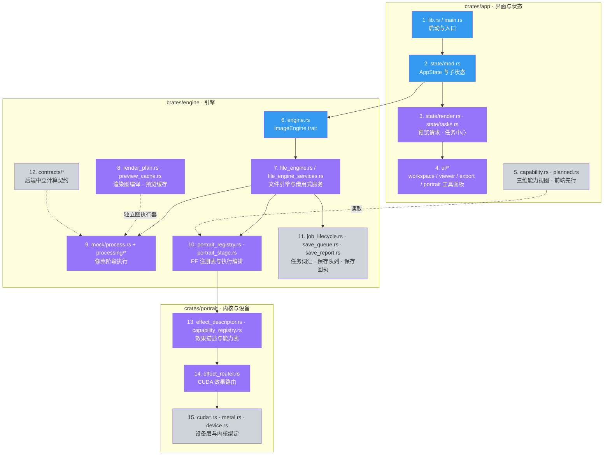
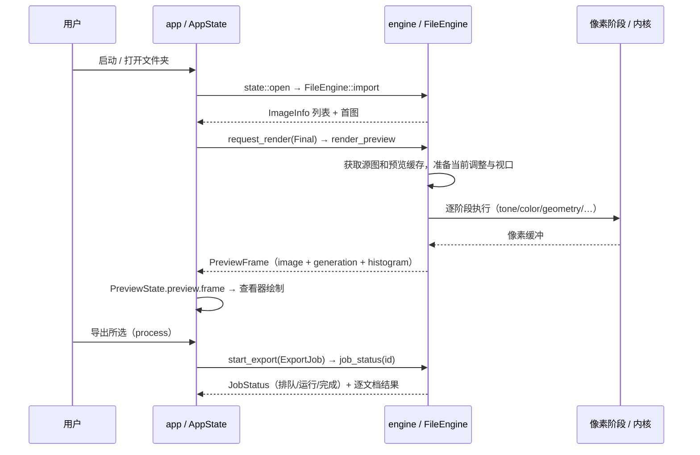
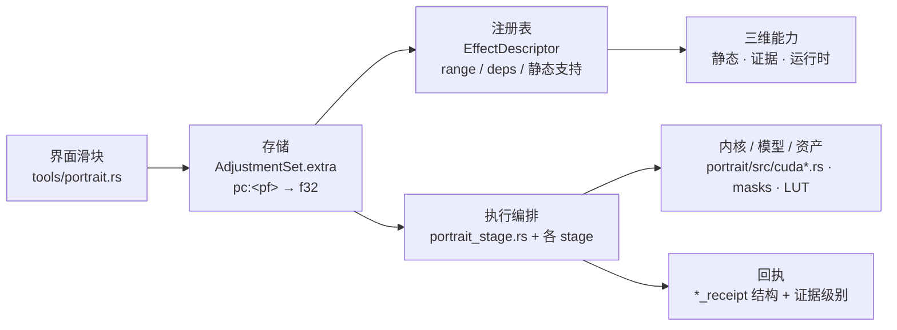

# Aurora Studio 代码地图（新人向）

这份文档把仓库讲成一张可以走的地图：代码分成哪几块、一次「开图 → 预览 → 出图」到底经过哪些函数、人像 147 项 PF 靠什么契约串起来、哪些是已经落地的管道、哪些只是契约或规划。

> 阅读约定
> - **事实源**：本文件只描述公开仓库 `main`（`74179b3c`）里的代码。凡不在 `main` 的东西都会明确标注「不在 main」。
> - **本文不是健康评分**，也不做缺陷归因；已有的决策与验证记录分别在 [ARCHITECTURE-ADR.md](./ARCHITECTURE-ADR.md)、[ARCHITECTURE-VALIDATION.md](./ARCHITECTURE-VALIDATION.md)，本文只负责指路。
> - 术语第一次出现时给中文释义，文末第 12 节是术语表。

---

> 干净公开 `main` 含引用外部文件的编译期输入。此次 locked 元数据通过，workspace 检查因这些文件缺席返回 101；下面是源码路径导览，不是干净机器构建通过报告。

## 1. 一分钟总览

三个 crate，一条单向依赖：

| crate | 包名 | 负责 |
|---|---|---|
| [crates/app](../../crates/app) | `portrait-app` | GPUI 桌面界面与交互状态；只通过 `ImageEngine` trait 请求引擎做事 |
| [crates/engine](../../crates/engine) | `aurora-engine` | RAW 解码、渲染计划与像素执行、导出/打印、持久化队列、人像效果编排 |
| [crates/portrait](../../crates/portrait) | `aurora-portrait` | 人像效果的 GPU 内核与设备层（CUDA / Metal）、效果 descriptor 与能力表；不依赖 engine |

依赖方向是 **app → engine → portrait**，不允许反向（由 [ARCHITECTURE-CHECKS.md](./ARCHITECTURE-CHECKS.md) 的规则 1–3、7 用集成测试守着）。这里的"依赖"只说 **workspace crate**：engine 另外还依赖 `serde`/`serde_json`/`anyhow`/`log`、`image`、`memmap2`、`rayon`、`parking_lot`、`roxmltree`、`tiff`、`flate2`、`crc32fast`、`rusqlite`，macOS 上再加 `objc2-metal` 系列。技术栈：Rust（edition 2024）、GPUI（`gpui-kit` / `ely-core`，Windows 上经 Direct3D 11 呈现）、CUDA 与 Metal 计算、可选 ONNX Runtime。

> 本文对 `main`（`74179b3c`，2026-11-25）逐文件核对；`crates/app` 的依赖只有 `aurora-engine`、`gpui-kit`、`ely-core`，不含 `aurora-portrait`——界面拿不到内核，只能走引擎。

新人最容易踩的三个认知点：

1. **`main` 上没有零 ORT 推理引擎**。`native_infer/`（自带 ONNX 载入、图编译、算子内核）只存在于性能分支（见第 8 节）。`main` 的 AI 推理走 ONNX Runtime（[crates/engine/src/aimask/ort.rs](../../crates/engine/src/aimask/ort.rs)）。
2. **"规划图"和"真执行"是两层**。保存的是节点图（`AdjustmentSet::nodes`）；`RenderPlan` 是它的派生执行视图，只在 [render/execute.rs](../../crates/engine/src/render/execute.rs) 的 `PlanExecutor` 里被编译使用（`compile_document` 的唯一非测试调用在 L320），而该执行器目前**没有接到 live 预览**——实时预览走 `file_engine` 的 `preview_frame`/`render_preview` 到 `mock`/`processing`。`RenderPlan` 可以随时丢弃重建。
3. **能力有三个正交维度**：编译期静态支持、已验证证据、当前机器的运行时可用性。三者不能互相代替（ADR-007，见 [ARCHITECTURE-ADR.md](./ARCHITECTURE-ADR.md)）。

---

## 2. 阅读顺序与模块图

节点按**建议阅读顺序**着色（蓝=从这里开始，紫=接着读，灰=按需查），不是按重要性也不是按风险。



推荐顺序：

1. [crates/app/src/lib.rs](../../crates/app/src/lib.rs)（`run` 从第 98 行开始）——先看程序怎么起来。
2. [crates/app/src/state/mod.rs](../../crates/app/src/state/mod.rs)（`AppState` 与 `init_state`）——界面状态的唯一真相。
3. [crates/engine/src/engine.rs](../../crates/engine/src/engine.rs)（`ImageEngine` trait）——界面能看到的所有能力的边界。
4. [crates/engine/src/file_engine.rs](../../crates/engine/src/file_engine.rs) 的入口函数（`import`、`render_preview`、`save_adjustments*`、`export_source_plan`）。
5. 再看人像子系统：[portrait_registry.rs](../../crates/engine/src/portrait_registry.rs) → [portrait_stage.rs](../../crates/engine/src/portrait_stage.rs) → [effect_descriptor.rs](../../crates/portrait/src/effect_descriptor.rs) → [effect_router.rs](../../crates/portrait/src/effect_router.rs)。
6. 最后按需查 `contracts/`、`job_lifecycle.rs`、`save_queue.rs` 这些词汇层。

---

## 3. 模块导览

### 3.1 `crates/app`：界面与状态

- **入口**：[main.rs](../../crates/app/src/main.rs) 解析命令行开关，[lib.rs](../../crates/app/src/lib.rs) 的 `run()` 决定打开哪个目录/目录型 catalog，创建引擎（`state::open::open` 或 `state::open::demo`），再 `state::init_state`（[state/mod.rs](../../crates/app/src/state/mod.rs) 第 1968 行）建立 `AppState`，最后 `ui::workspace::open` 开窗。
- **状态拆分**：`AppState` 把库、编辑器、偏好、设备、预览、任务拆成子结构：`LibraryState`（[state/library.rs](../../crates/app/src/state/library.rs)，**已拆出**）、`EditorState`（[state/editor.rs](../../crates/app/src/state/editor.rs)）、`SettingsState`（[state/settings_state.rs](../../crates/app/src/state/settings_state.rs)）、`DeviceState`（[state/device.rs](../../crates/app/src/state/device.rs)）、`PreviewState`（[state/preview.rs](../../crates/app/src/state/preview.rs)）、`TaskCenter`（[state/tasks.rs](../../crates/app/src/state/tasks.rs)）。拆分是渐进的：手势与撤销仍有一部分在 `AppState` 的方法里。
  > [ARCHITECTURE-README 索引](./README.md)与 [ARCHITECTURE-MIGRATION-MAP.md](./ARCHITECTURE-MIGRATION-MAP.md) 里"`LibraryState` 尚未落地"的说法已过时：`state/library.rs` 在当前 `main` 上存在。
- **请求渲染**：[state/render.rs](../../crates/app/src/state/render.rs) 第 941 行的 `request_render(quality, cx)` 是"要一帧"的唯一入口，它把 `RenderQuality`、`last_request`、generation 记在 `PreviewState` 上，再调引擎。
- **界面件**：窗口骨架在 [ui/workspace.rs](../../crates/app/src/ui/workspace.rs)，查看器在 [ui/viewer/mod.rs](../../crates/app/src/ui/viewer/mod.rs)（第 623 行起的 `render` 直接读 `preview_state.preview.frame`），导出面板在 [ui/export.rs](../../crates/app/src/ui/export.rs)，人像控件在 [tools/portrait.rs](../../crates/app/src/tools/portrait.rs)。
- **能力视图**：[capability.rs](../../crates/app/src/capability.rs) 是 ADR-007 三个维度的界面侧镜像（不 import `aurora_portrait`，靠 `aurora-engine` 转述）；[planned.rs](../../crates/app/src/planned.rs) 是"前端先行"层：为引擎还没有的方法先做界面，调用时明确回答"未接通"，等引擎补方法后原地变成真调用。

### 3.2 `crates/engine`：引擎

- **公共面**：[engine.rs](../../crates/engine/src/engine.rs) 的 `ImageEngine` trait 是 app 唯一允许触碰的引擎接口（`images`、`import`、`load_adjustments`/`save_adjustments*`、`render_preview`、`pending_save_status`、导出与合并等）。
- **实现**：[file_engine.rs](../../crates/engine/src/file_engine.rs) 是 `FileEngine`；[file_engine_services.rs](../../crates/engine/src/file_engine_services.rs) 把引擎拆成十个**借用式服务**（Catalog / Source / Render / Inference / Capture / Export / Merge / Persistence / Import / Library），trait 方法保留为委托（规则 10）。
- **解码与缓存**：[raw.rs](../../crates/engine/src/raw.rs)（RAW 解码）、[raw_cache.rs](../../crates/engine/src/raw_cache.rs)、[preview_cache.rs](../../crates/engine/src/preview_cache.rs)。
- **渲染图**：[render_plan.rs](../../crates/engine/src/render_plan.rs) 把保存的节点图编译成 `RenderPlan`。真实类型：`RenderPlan { order: Vec<NodeId>, pruned: Vec<NodeId>, warnings: Vec<GraphWarning>, .. }`（L115），配 `DirtySet { nodes, global }`（L321）、`BackendTag { name, equivalence }`（L564）、`CacheContext { source_identity, roi, color_space, precision, algorithm_version, backend }`（L636）与 `NodeCacheKey { node, revision, .. }`（L672）。`compile_document(&AdjustmentSet)` 在 L217。**它只产出计划，不碰像素、不改文档**；当前 `main` 上它的**唯一非测试调用**在 [render/execute.rs](../../crates/engine/src/render/execute.rs) L320（`PlanExecutor::execute` 内部），而 `PlanExecutor` / `execute_with_plan` 目前**没有被 live 预览接线**——实时预览仍走 `file_engine` 的 `preview_frame`/`render_preview` 到 `mock`/`processing`。别把"计划已编译"当成"预览一定走这条执行器"。
- **像素执行**：[mock/process.rs](../../crates/engine/src/mock/process.rs) 是长期存在的执行外壳，纯阶段已陆续搬到 [processing/](../../crates/engine/src/processing)（`tone`/`color`/`geometry`/`clarity`/`grain`/`spots`/`statistics`/`encoding`/`frame_map`），`mock` 保留 re-export 以免旧调用点中断。
- **人像编排**：[portrait_registry.rs](../../crates/engine/src/portrait_registry.rs)（注册表与三维能力）、[portrait_stage.rs](../../crates/engine/src/portrait_stage.rs)（PF 行执行编排）、[portrait_face_input_stage.rs](../../crates/engine/src/portrait_face_input_stage.rs)（输入票据/几何）、[portrait_map.rs](../../crates/engine/src/portrait_map.rs)（PF 语义表），以及按能力分家的 `portrait_plump_stage.rs`、`portrait_eye_bag_stage.rs`、`portrait_makeup_*.rs`、`portrait_body_stage.rs`、`portrait_repair_stage.rs` 等。
- **词汇层**：[job_lifecycle.rs](../../crates/engine/src/job_lifecycle.rs)、[save_queue.rs](../../crates/engine/src/save_queue.rs)、[save_report.rs](../../crates/engine/src/save_report.rs)、[document.rs](../../crates/engine/src/document.rs)、[contracts/](../../crates/engine/src/contracts)（`frame`/`compute`/`identity`，仅依赖标准库与 serde）。

### 3.3 `crates/portrait`：内核与设备

- **效果描述**：[effect_descriptor.rs](../../crates/portrait/src/effect_descriptor.rs) 定义 `EffectDescriptor` 与 `StaticState`/`EvidenceLevel` 一类的维度词汇；[capability_registry.rs](../../crates/portrait/src/capability_registry.rs) 是效果 × 能力的状态表。
- **路由**：[effect_router.rs](../../crates/portrait/src/effect_router.rs) 把 PF 名映射到具体 CUDA 内核（`ADAPTERS` 表 + `route()`），未覆盖的 PF 必须**拒绝**而不是静默跳过。
- **设备层**：[cuda.rs](../../crates/portrait/src/cuda.rs)（驱动、PTX 载入、launch）、[metal.rs](../../crates/portrait/src/metal.rs)（Metal 运行时）、[device.rs](../../crates/portrait/src/device.rs)（设备选择）、[cuda_job_upload.rs](../../crates/portrait/src/cuda_job_upload.rs)（上传计划）；内核源码在 [native/cuda/](../../crates/portrait/native/cuda) 与 [native/metal/](../../crates/portrait/native/metal)。

---

## 4. 一次「开图 → 预览 → 出图」

### 4.1 时序



### 4.2 具体落点

1. **启动**：[lib.rs](../../crates/app/src/lib.rs) `run()`（L98）→ 选源目录 `state::open::open`（L114）或 `state::open::demo`（L117）→ `state::init_state`（L183）→ `ui::workspace::open`（L207）。`state::open` 模块本体在 [state/mod.rs](../../crates/app/src/state/mod.rs)（L53 起）。
2. **打开/导入**：`FileEngine::import`（[file_engine.rs](../../crates/engine/src/file_engine.rs) L4086）与 `import_c1`（L2710）；RAW 解码在 [raw.rs](../../crates/engine/src/raw.rs)，结果进 [raw_cache.rs](../../crates/engine/src/raw_cache.rs)。
3. **要一帧**：`request_render`（[state/render.rs](../../crates/app/src/state/render.rs) L941）→ 引擎 `render_preview`（[file_engine.rs](../../crates/engine/src/file_engine.rs) L4438）/ `preview_frame`（L3393，供快速档）→ [mock/process.rs](../../crates/engine/src/mock/process.rs) 与 [processing/](../../crates/engine/src/processing) 执行。
4. **帧的形状**：`PreviewRequest`（[engine.rs](../../crates/engine/src/engine.rs) L64，含 `quality`/`generation`/`max_size`）与 `PreviewFrame`（同文件 **L130**：`image: RgbaImage` + `histogram` + `generation` + `elapsed_ms` + `degraded` + `gamut_warning` + `bgra`）。**宽高来自 `frame.image`，`quality` 不在帧上**——它记在请求里，界面侧存在 `PreviewState.last_request`。GUI 在 [ui/viewer/mod.rs](../../crates/app/src/ui/viewer/mod.rs) L623 起的 `render` 里消费 `preview_state.preview.frame`。[contracts/frame.rs](../../crates/engine/src/contracts/frame.rs) 是**后端中立的通用描述符**（`PlaneLayout`、`PlaneSpec`、`PlanarLayout`、`ValidRegion`、`FrameDescriptor`），不是预览帧类型。
5. **出图**：界面在 [ui/export.rs](../../crates/app/src/ui/export.rs)（含原子写入助手 `publish_new` / `write_new_atomic`）；真正的提交入口是 `AppState::process(recipes, cx)`（[state/mod.rs](../../crates/app/src/state/mod.rs) L1916）——对每张选中图、每个配方 `tasks.reserve_job_id()` → `engine.start_export(ExportJob)`（trait 方法，[engine.rs](../../crates/engine/src/engine.rs) L824）→ `tasks.push_job(JobView)` → `poll_jobs` 每 120 ms 问 `engine.job_status(id)`（L825）。引擎侧落到 `export_source_plan`（[file_engine.rs](../../crates/engine/src/file_engine.rs) L3241）、[output.rs](../../crates/engine/src/output.rs)、[c1session_export.rs](../../crates/engine/src/c1session_export.rs)，导出预算与调度在同文件（`export_budget_ceiling`、`export_scheduler`）。注意 `state/mod.rs` L2721 的 `start_export` 是 `#[cfg(test)]` 里的假引擎实现，不是真实路径。

---

## 5. PF 人像的数据契约

人像 147 项效果（PF）在这份代码里是**五层**串起来的，改任何一层都要先确认另外四层的口径。



1. **存储层**：所有 PF 参数存在 `AdjustmentSet` 的 `extra: BTreeMap<String, f32>`，键名是 `pc:<pf 数字>`（[recipe.rs](../../crates/engine/src/recipe.rs)；`EffectId::parse_pf_from_store_key` 见 [portrait_registry.rs](../../crates/engine/src/portrait_registry.rs)）。C1 的 72 个滑块另有元数据与前端契约：[param_meta.rs](../../crates/engine/src/param_meta.rs)、[param_contract.rs](../../crates/engine/src/param_contract.rs)。
2. **注册表层**：每个 PF 一条 `EffectDescriptor`（`id` / `category` / `section` / `label_en` / `label_zh` / `range: ParamRange` / `dependencies` / `static_support`）在 [portrait_registry.rs](../../crates/engine/src/portrait_registry.rs)。要紧的是把五件事分开看：**登记**（表里有这一条）、**接线**（stage 里真的有分支）、**运行**（这台机器/这张图跑得起来）、**出像素**（真的改变了图像）、**原参考**（与原厂同图对拍一致）。一条 descriptor 存在，只说明第一件事。`ParamRange` 声明的是**存取单位**：`Normalized01`、`SignedPercent`、`Scalar`。这里的单位必须和读取端一致——例如全脸丰盈 `pc:30210` 在管线里只接受整数 `0..=4`（[portrait_plump_stage.rs](../../crates/engine/src/portrait_plump_stage.rs) 的 `full_face_descriptor_from_ui`），注册表就不能声明成 `-100..100`。
3. **能力层**：三个正交维度——`StaticSupport`（编译期有没有 CPU/CUDA/Metal 实现与接线）、`EvidenceLevel`（有没有被合成测试、GPU 运行、同 job 输入、EV6 对拍证明过）、`RuntimeAvailability`（这台机器、这张图现在能不能跑）。界面镜像在 [capability.rs](../../crates/app/src/capability.rs)，"未接通"的前端先行在 [planned.rs](../../crates/app/src/planned.rs)。
4. **执行层**：`portrait_stage.rs` 定义这层的词汇——`PortraitBackend`（L461）、`PortraitSkipReason`（L490）、`PortraitEffectRun`（L497）、`PortraitRunReport`（L512）、`PortraitRuntimeStatus`（L533）、`PortraitGeometryRun`（L710）、`ProducerInputs`（L729）——再按 PF 分派到具体 stage：`portrait_plump_stage.rs`、`portrait_eye_bag_stage.rs`、`portrait_makeup_bundle.rs`、`portrait_makeup_wiring.rs`、`portrait_body_stage.rs`、`portrait_repair_stage.rs`、`portrait_slim_stage.rs` 等；PF 语义表在 [portrait_map.rs](../../crates/engine/src/portrait_map.rs)。
5. **输入与回执**：人像输入（关键点、分割掩码、牙齿/眼/发掩码、模型输出）来自 [aimask/](../../crates/engine/src/aimask)、[face_parsing.rs](../../crates/engine/src/face_parsing.rs)、[beautymarks.rs](../../crates/engine/src/beautymarks.rs)、[dustdetect.rs](../../crates/engine/src/dustdetect.rs) 等；每个需要证据的阶段会产出 `*Receipt`（例如 `SmileHostSplitReceipt`、`FaceGeometryProviderReceipt`、`Pf8033TensorReceipt`）。

前端口径的清单与证据说明在：[portrait-algorithms.json](../frontend-contract/portrait-algorithms.json)、[portrait-capability-registry-20261124.tsv](../frontend-contract/portrait-capability-registry-20261124.tsv)、[portrait-evidence.md](../frontend-contract/portrait-evidence.md)。

---

## 6. 计算后端与 Rust–ONNX

**`main` 上真实存在的三条计算路径：**

| 路径 | 代码 | 说明 |
|---|---|---|
| CPU 参考 | [processing/](../../crates/engine/src/processing)、各内核的 CPU 分支 | 永远有；GPU 缺失或请求不被支持时的裁决者 |
| CUDA | [crates/portrait/src/cuda.rs](../../crates/portrait/src/cuda.rs) + [native/cuda/](../../crates/portrait/native/cuda) + [effect_router.rs](../../crates/portrait/src/effect_router.rs) | Windows/NVIDIA；PTX 平台门控（规则 5） |
| Metal | [crates/portrait/src/metal.rs](../../crates/portrait/src/metal.rs) + [native/metal/](../../crates/portrait/native/metal) | macOS；与 CUDA 同接口、不同实现 |

**推理（Rust–ONNX）**：`main` 的 AI 推理由 ONNX Runtime 承担——[aimask/ort.rs](../../crates/engine/src/aimask/ort.rs) 负责载入 DLL、建 session、按 provider 选择设备；DLL 缺失时降级并且**如实回报**（[aimask/mod.rs](../../crates/engine/src/aimask/mod.rs) 头部的说明）。后端无关的词汇（帧、坐标、能力、派发记录）在 [contracts/](../../crates/engine/src/contracts)：`frame`（像素与帧描述）、`compute`（设备能力与派发）、`identity`（身份/版本）；这些类型只依赖标准库与 serde，任何后端都要同意同一套词汇。

**不在 `main`**：零 ORT 的 `native_infer`（自带 ONNX 解析、图编译、CUDA 算子、`selfcheck`）只在性能分支；WGPU/Vulkan 后端目前只出现在任务书的平台目标里，`main` 里没有 `wgpu`/`dx12` 文件。详见第 8 节。

---

## 7. 任务、回执与保存队列

三层要分清楚：

1. **界面任务中心**：[state/tasks.rs](../../crates/app/src/state/tasks.rs) 的 `TaskCenter` 只是数据：`reserve_job_id`/`push_job`/`start_job`，为导出任务保序、暴露 `busy` 标记；它没有自己的事件总线，界面仍观察 `AppState`。
2. **统一任务词汇**：[job_lifecycle.rs](../../crates/engine/src/job_lifecycle.rs) 定义 `JobId`/`JobState`/取消令牌/进度/资源预约/派发证据，并带一个进程内 registry。**它是词汇 + registry，不是已接线的调度器**——现有单飞门（`file_engine`、`merge_async`、`recipe`、`mock/*`）没有被它替换，导出是第一个接入方。
3. **保存**：同步路径 `save_adjustments` / `save_adjustments_batch(_report)`（[file_engine.rs](../../crates/engine/src/file_engine.rs) L4293/L4297/L4307）会给出逐文档结果 `SaveReport`（[save_report.rs](../../crates/engine/src/save_report.rs) L83）。**`SaveReport` 属于"调整保存"，不是导出回执**：导出侧的可见结果是 `JobStatus`/`JobView`（见上一节），逐文档的导出结果由引擎在导出任务内部汇总。队列路径 `save_adjustments_queued`（L4314）走 [save_queue.rs](../../crates/engine/src/save_queue.rs)：有界、单写者线程、按文档保序、合并更新的编辑、`flush` 报告真正落盘的条目，并在"内存已接受"与"已写盘"之间显式给出"排队中"状态（`pending_save_status`，[engine.rs](../../crates/engine/src/engine.rs) L565）。退出前由 `flush_and_quit` 一类路径保证队列排空。

回执（receipt）不是日志：它是**同 job 证据**，用于回答"这次效果到底用什么输入、跑了哪条后端、产出是否与输入同一帧"。人像侧的 `*Receipt` 结构散布在对应 stage 文件里，后端侧的派发证据在 [contracts/compute.rs](../../crates/engine/src/contracts/compute.rs)。

---

## 8. 版本坐标：`main` / perf 分支 / C4 / 缺失的 7056ada

| 坐标 | 是什么 | 怎么对待 |
|---|---|---|
| `main` = `74179b3c` | 公开主分支（2026-11-25） | **本文唯一事实源**；任何"仓库现状"以它为准 |
| `4a05bff13` | 最近的公开性能分支，`main` 之后 **20 个提交**（`git log main..4a05bff` 可数） | 领先内容：零 ORT `native_infer`（ONNX 载入/图编译/CUDA 算子/多模型验证）、渐进式内嵌 JPEG 首帧、冷 RAW 首载提速、Z6III HE 原生 GPU 管线等；整体 diff 155 文件、+52156/−1459。引用它时要写明**不在 main** |
| 「累计补丁缺 4 个文件」 | 指把合作者累计补丁覆盖到 `4a05bff` 时，**补丁要改写的目标 blob 有 4 个在公开树上找不到**（补丁的 base/target 与公开提交并不重合） | 这是补丁与公开快照对不上的问题，**与 C4 无关**；不要据此推断某个树不完整 |
| C4（候选四版） | 一次**独立的候选构建**：相对性能基线改动 91 个文件，834 个源文件完整冻结，**不是 `main` 上的提交**，也不是"缺 4 文件的那棵树" | 只能作为候选验证对象；当基线或当源码真相都会错 |
| `7056ada9` | 合作者任务书里引用的代码基线提交 | 在本仓库公开历史里找不到这个对象，因此本文不引用它；如需该基线，须由持有者提供 |

判断一段代码属于哪一层的三步：

```bash
git log --oneline main..4a05bff -- crates/portrait/src/native_infer   # 在 perf 分支上独有
git show main:crates/engine/src/engine.rs | head -40                  # main 的真实公共面
git ls-tree -r main -- crates/engine/src | wc -l                      # 别用别的树的目录清单猜
```

---

## 9. 规划图 vs 真 pipeline

| 表面 | 真实执行 | 证据 |
|---|---|---|
| 节点图（用户搭的拓扑，存 `AdjustmentSet::nodes`） | 可编译成 `RenderPlan`（`compile_document`，唯一非测试调用在 [render/execute.rs](../../crates/engine/src/render/execute.rs) L320）；该执行器尚未接入 live 预览，计划可丢弃重建、不改文档 | [render_plan.rs](../../crates/engine/src/render_plan.rs) 头部 |
| `mock/process.rs` 里的阶段名 | 一部分已迁到 `processing/*`，`mock` 只保留 re-export | [processing/mod.rs](../../crates/engine/src/processing/mod.rs) |
| `planned.rs` 的"引擎方法" | 引擎还没有该方法时明确回答"未接通"，`contract` 状态标记控件 | [planned.rs](../../crates/app/src/planned.rs) 头部 + [engine-requests.md](../frontend-contract/engine-requests.md) |
| `capability.rs` 的能力状态 | 三维取交集才叫"可用"；`StoredOnly`/`MissingModel`/`MissingAsset`/`MissingInput` 是显式回报 | [capability.rs](../../crates/app/src/capability.rs) + [A-REGISTRY-AUDIT.md](./A-REGISTRY-AUDIT.md) |
| [node-graph.md](../frontend-contract/node-graph.md) 的字段表 | 是前端契约，不是实现 | 契约文件本身 |
| 人像 147 项目标 | 登记 ≠ 接线 ≠ 运行 ≠ 出像素 ≠ 原参考对拍；每一步单独成立、单独回报 | [portrait_registry.rs](../../crates/engine/src/portrait_registry.rs) + [portrait-evidence.md](../frontend-contract/portrait-evidence.md) |

---

## 10. 想改某类能力，从哪下手

| 你想做的事 | 先改这里 | 然后别忘了 |
|---|---|---|
| **新增/修正一个 PF** | [portrait_registry.rs](../../crates/engine/src/portrait_registry.rs)（descriptor：分类/标签/单位/依赖/静态支持） | 执行分支（对应 `portrait_*_stage.rs`）→ 内核（`crates/portrait/src/cuda_*.rs`）→ 证据（`capability_registry`/TSV）→ 前端契约（[portrait-algorithms.json](../frontend-contract/portrait-algorithms.json)） |
| **改某 PF 的存储单位或范围** | 同一个 `ParamRange` **以及**读取它的 stage | 读取端的 clamp/拒绝逻辑（如 `full_face_descriptor_from_ui` 只收 0..4 整数），并补一条"可存 ⇔ 可读"的单测 |
| **加一项新的人像输入（掩码/关键点/模型）** | [aimask/](../../crates/engine/src/aimask)、对应 `portrait_*_inputs.rs`/provider | `InputDependency` 变体 + 注册表依赖 + 证据级别（没有真输入就别报可用） |
| **改预览路径/帧质量** | [state/render.rs](../../crates/app/src/state/render.rs) 的 `request_render` + [file_engine.rs](../../crates/engine/src/file_engine.rs) 的 `preview_frame`/`render_preview` + [render_plan.rs](../../crates/engine/src/render_plan.rs) | 帧身份（代次/质量）与 [contracts/frame.rs](../../crates/engine/src/contracts/frame.rs)；性能结论必须给冷/暖帧与 P50/P95 |
| **改 RAW 解码** | [raw.rs](../../crates/engine/src/raw.rs)、[raw_cache.rs](../../crates/engine/src/raw_cache.rs) | 缓存键与像素一致性；C1 相关的部分在 `c1_*.rs` |
| **改导出/打印** | [ui/export.rs](../../crates/app/src/ui/export.rs)（界面）、[file_engine.rs](../../crates/engine/src/file_engine.rs) 的 `export_source_plan`/`export_scheduler`、[output.rs](../../crates/engine/src/output.rs)、[c1session_export.rs](../../crates/engine/src/c1session_export.rs) | 逐任务 `JobStatus`（`AppState::process`→`poll_jobs`）、内存预算、禁止放大 proxy（ADR-012） |
| **改持久化/保存语义** | [save_queue.rs](../../crates/engine/src/save_queue.rs)、[save_report.rs](../../crates/engine/src/save_report.rs)、[document.rs](../../crates/engine/src/document.rs) | `pending_save_status`、退出 flush、单写者不变量 |
| **加一个计算后端** | [contracts/](../../crates/engine/src/contracts) 的词汇 → [device.rs](../../crates/portrait/src/device.rs)/[cuda.rs](../../crates/portrait/src/cuda.rs)/[metal.rs](../../crates/portrait/src/metal.rs) 之一 | 与 CPU 参考的对拍阈值、派发证据、平台门控（规则 4/5/6） |
| **改界面控件与命令** | [ui/](../../crates/app/src/ui) + [actions.rs](../../crates/app/src/actions.rs) | 能力状态驱动可用性（只 `Available` 可交互），别在界面写死后端不存在的能力 |
| **改架构规则本身** | [ARCHITECTURE-CHECKS.md](./ARCHITECTURE-CHECKS.md) + [architecture_rules.rs](../../crates/engine/tests/architecture_rules.rs) | 规则改动要在 ADR 里留痕 |

---

## 11. 约定与危险区（不是评分）

**约定**

- 目录按**层**分（app / engine / portrait），层内按子域分；人像子系统倾向"一个能力族一个 stage 文件"。
- 错误处理：引擎对外返回 `anyhow::Result`，人像/计算层用显式 `Refusal`/错误枚举**拒绝**而不是静默回退；缺模型/缺资产/缺输入必须报出来。
- 测试：单测与源码同文件（`#[cfg(test)] mod tests`），跨模块契约用集成测试（[crates/engine/tests/](../../crates/engine/tests)），架构规则用普通 Rust 测试执行（ADR-008）。
- 依赖注入：不引 DI 框架、不引 async runtime（ADR-009）；服务借用引擎（规则 10）。

**动手前先看的重文件（不是因为"坏"，是因为牵一发动全身）**

- [portrait_stage.rs](../../crates/engine/src/portrait_stage.rs)、[portrait_face_input_stage.rs](../../crates/engine/src/portrait_face_input_stage.rs)：PF 分派与输入票据都在这里，改一行会波及多族效果。
- [file_engine.rs](../../crates/engine/src/file_engine.rs)、[file_engine_services.rs](../../crates/engine/src/file_engine_services.rs)：引擎公共面的实现与委托，trait 改动要同步服务层。
- [c1session_export.rs](../../crates/engine/src/c1session_export.rs)、[recipe.rs](../../crates/engine/src/recipe.rs)、[adjust.rs](../../crates/engine/src/adjust.rs)：C1 兼容与存档格式，改动必须带旧数据回读测试。
- 共享结构体/枚举（`EffectDescriptor`、`ParamRange`、`InputDependency`、`StaticSupport`、`JobState`）：改签名前**全仓 grep 所有构造点**，包括 `crates/app` 的镜像类型。
- `mock/process.rs` 与 `processing/*` 的双份名字：新增阶段要决定放哪一侧，别两边都写。

---

## 12. 术语表

| 术语 | 含义 |
|---|---|
| PF / `pc:<pf>` | 人像效果编号；存储键是 `pc:<数字>`，如 `pc:30210` |
| `AdjustmentSet` | 一张图的完整调整存档（含 `nodes` 节点图与 `extra` 里所有 `pc:*`） |
| `ImageEngine` / `FileEngine` | 界面能看到的引擎 trait / 其文件系统实现 |
| `RenderPlan` | 由节点图编译出的执行视图（顺序、脏节点、缓存身份） |
| `PreviewRequest` / `PreviewFrame` | 要一帧的请求（含 `quality`/`generation`/`max_size`）/ 回来的帧（`image` + `histogram` + `generation`，宽高取自 `image`） |
| 三维能力 | 静态支持 / 已验证证据 / 运行时可用性 |
| `StaticSupport` | 编译期是否有 CPU/CUDA/Metal 实现与接线 |
| `EvidenceLevel` | 证据级别（合成测试 → GPU → 同 job → 主预览 → 原厂对拍 → 真照片） |
| `RuntimeAvailability` | 当前机器与当前图是否真的能跑（含缺模型/缺资产/缺输入） |
| `Refusal` / `StoredOnly` | 显式拒绝 / 只存不跑，不允许伪装成可用 |
| `TaskCenter` | 界面侧任务账本（job id、busy 标记、顺序） |
| `job_lifecycle` | 引擎侧统一任务词汇 + 进程内 registry（**不是**调度器） |
| `save_queue` | 有界单写者持久化队列（合并更新、flush 报告） |
| 回执 / receipt | 同 job 证据：输入、后端、派发与输出身份 |
| `contracts` | 后端中立的帧/计算/身份词汇，零上层依赖 |
| 零 ORT / `native_infer` | 自带 ONNX 解析与算子的推理引擎；**只在性能分支** |

---

## 13. 新人第一批任务（低风险、边界清晰）

1. **给一个已接线 PF 补测试**：在 [portrait_registry.rs](../../crates/engine/src/portrait_registry.rs) 的 `mod tests` 里加"声明与读取一致"的断言（范围、单位、依赖、默认值），例如断言某个 `ParamRange` 允许存的值恰好是读取端接受的集合。改动只在一个文件，回归风险低，且能立刻抓到单位漂移。
2. **补齐 `processing/` 的一处 re-export 迁移**：挑一个仍在 `mock` re-export 的纯阶段，把调用点迁到 [processing/](../../crates/engine/src/processing) 并保留 shim，跑对应单测。边界清楚，能熟悉层规则（规则 8）。
3. **给前端契约加一条可执行校验**：在 `param_contract`/`portrait_registry` 侧加一个读取 [frontend-contract](../frontend-contract) 的测试，断言契约里的条目与注册表不冲突。只读契约、只加测试，适合第一周。

---

## 附：本文如何核对（不留本机痕迹的命令）

```bash
git show main:crates/engine/src/engine.rs | sed -n '380,420p'   # 公共面
git log --oneline main..<perf-branch>                            # 分支差
git ls-tree -r main -- crates/portrait/src/native_infer          # 空 = main 没有零 ORT
```

修改本文件时请保持：相对链接可用、术语与代码同名、任何"已验证/未验证"的说法都能追到 [ARCHITECTURE-VALIDATION.md](./ARCHITECTURE-VALIDATION.md) 里的实际命令。
